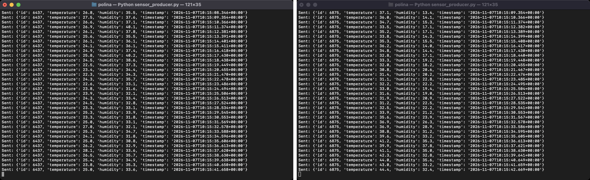
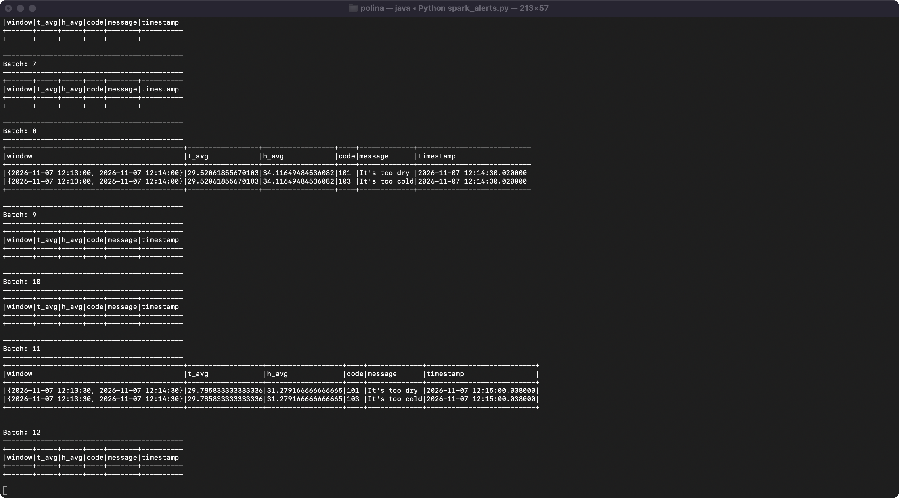
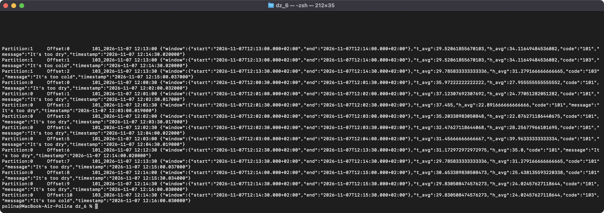

# goit-de-hw-06 — Spark Streaming

Моніторинг IoT-датчиків: датчики пишуть температуру й вологість у Kafka, Spark Structured Streaming рахує середні значення в ковзному вікні, зіставляє їх з умовами з [alerts_conditions.csv](alerts_conditions.csv) і записує алерти в окремий Kafka-топік.

```
sensor_producer.py (×N) ──> polina_dyka_building_sensors ──> spark_alerts.py ──> polina_dyka_alerts ──> alerts_consumer.py
                                                                   ▲
                                                       alerts_conditions.csv
```

| Файл | Що робить |
|---|---|
| [configs.py](configs.py) | Параметри підключення (для kafka-python і для Spark), імена топіків з префіксом `polina_dyka_` |
| [create_topics.py](create_topics.py) | Створює топіки `building_sensors` і `alerts` |
| [sensor_producer.py](sensor_producer.py) | **Крок 1.** Один запуск = один датчик зі сталим випадковим `id`; щосекунди надсилає `id`, `temperature`, `humidity`, `timestamp` |
| [spark_alerts.py](spark_alerts.py) | **Кроки 2–5.** Агрегація, cross join з умовами, фільтр, запис алертів у Kafka |
| [alerts_consumer.py](alerts_consumer.py) | Читає топік алертів і виводить повідомлення |
| [alerts_conditions.csv](alerts_conditions.csv) | Умови алертів (файл із завдання) |

## Як це працює

1. **Генерація даних.** Показники кожного датчика змінюються випадковим блуканням у межах 15–55 °C і 10–90 %. Якби кожне значення було незалежним випадковим числом, середнє за хвилину з ~60 значень завжди було б біля середини діапазону й алертів майже не було б. Блукання дає повільний дрейф, тож середні час від часу виходять за межі.
2. **Агрегація.** `withWatermark("event_time", "10 seconds")` + `groupBy(window("event_time", "1 minute", "30 seconds"))` → `avg(temperature) AS t_avg`, `avg(humidity) AS h_avg`. Час події береться з поля `timestamp` повідомлення, а не з часу отримання. Середнє рахується по всіх датчиках разом, як у прикладі повідомлення із завдання (там немає `id`).
3. **Умови алертів** читаються з CSV під час старту (`spark.read.csv`), тому зміна критеріїв не потребує зміни коду, лише перезапуску.
4. **Визначення алертів.** `averages.crossJoin(conditions)` і фільтр: для кожної межі `(min == -999 OR avg >= min) AND (max == -999 OR avg <= max)`, окремо для температури й вологості. Значення `-999` означає, що межа не перевіряється. Одне вікно може дати кілька алертів, наприклад, одночасно «too hot» і «too dry».
5. **Запис у Kafka.** `to_json(struct(window, t_avg, h_avg, code, message, timestamp))` → топік `polina_dyka_alerts`, ключ — `<code>_<window start>`. Режим `append`: вікно потрапляє у вихід один раз, коли watermark пройде його кінець, тобто середні вже остаточні з урахуванням даних, що запізнилися до 10 с. Ті самі рядки дублюються в консоль.

Приклад повідомлення в топіку `polina_dyka_alerts`:

```json
{
  "window": {"start": "2026-11-07T12:01:00.000+02:00", "end": "2026-11-07T12:02:00.000+02:00"},
  "t_avg": 37.12307692307692,
  "h_avg": 24.77051282051282,
  "code": "101",
  "message": "It's too dry",
  "timestamp": "2026-11-07 12:02:30.017000"
}
```

Для перевірки середнє для цього вікна перераховано вручну з логів двох датчиків: 78 показань, t = 37.1231, h = 24.7705. Результат збігається зі Spark.

## Запуск

Python 3.13, PySpark 4.0.1 (Java 17), kafka-python 2.2.15. Kafka 3.9 (KRaft, один вузол) піднімається з [docker-compose.yml](docker-compose.yml). Конектор `spark-sql-kafka-0-10_2.13:4.0.1` Spark завантажує сам під час першого запуску.

```bash
docker compose up -d
python -m venv .venv && source .venv/bin/activate
pip install -r requirements.txt
python create_topics.py
```

Далі в окремих терміналах:

```bash
python spark_alerts.py
python sensor_producer.py   # у 2+ терміналах — це 2+ датчики
python alerts_consumer.py
```

Перші алерти з'являються приблизно через 1,5 хв: вікно має закритися, а watermark — пройти його кінець.

Для віддаленого кластера задайте `KAFKA_BOOTSTRAP_SERVERS`, `KAFKA_USERNAME`, `KAFKA_PASSWORD` (SASL_PLAINTEXT / PLAIN).

## Скриншоти

### 1. Генерація даних сенсорів двома датчиками одночасно

Два запуски `sensor_producer.py` з різними `id` паралельно пишуть у `polina_dyka_building_sensors`:



### 2. Агрегація та визначення алертів у Spark

Вивід `spark_alerts.py`: мікробатчі з алертами (вікно, середні значення, код, повідомлення). Порожні батчі — тригери, у яких жодне вікно ще не закрилося. Одне вікно може дати кілька алертів: тут середні одночасно підпадають під «too dry» (h ≤ 40) і «too cold» (t ≤ 30):



### 3. Алерти в Kafka-топіку

Вміст `polina_dyka_alerts`, прочитаний з брокера:

```bash
docker exec kafka /opt/kafka/bin/kafka-console-consumer.sh --bootstrap-server localhost:9092 \
  --topic polina_dyka_alerts --from-beginning --timeout-ms 4000 \
  --property print.partition=true --property print.offset=true --property print.key=true 2>/dev/null
```

Зліва партиція й offset, далі ключ (`<code>_<window start>`) і JSON алерту. Усього в топіку 14 алертів з двох запусків.


